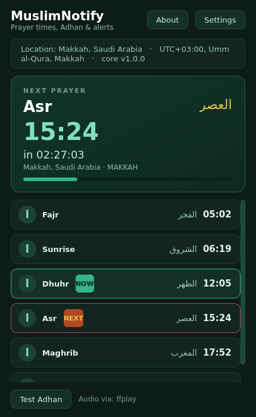
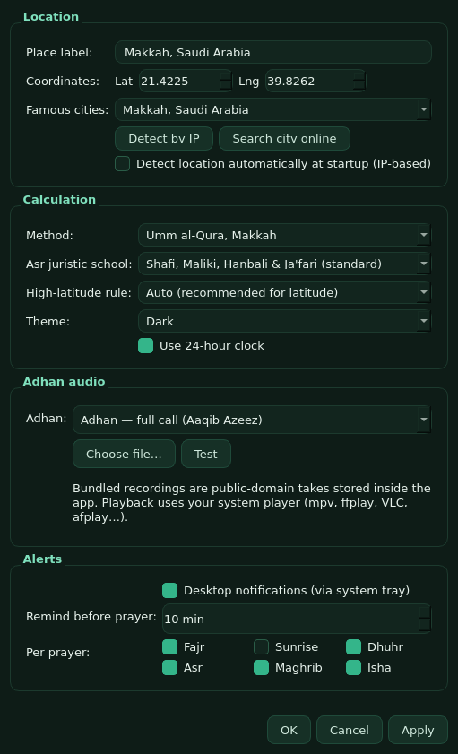

# BETA VERSION (NOT FULLY WORKING)

<div align="center">

# 🕌 MuslimNotify

**Prayer times, Adhan playback & desktop alerts — a native app with a Rust core and a Qt/C++ frontend.**

[](LICENSE)
[](crates/)
[](cpp/)
[](#contributing)

*Fajr · Dhuhr · Asr · Maghrib · Isha — computed locally, announced beautifully.*

</div>

---

## Screenshot

<p align="center">
  
  &nbsp;&nbsp;
  
</p>

## Why another prayer app?

MuslimNotify is a **desktop-first, privacy-first** alternative to the phone-app
monoculture. It is fully open source, computes every prayer time **on your
machine** with no network round trip, and never ships your location anywhere —
there is not even a server to send it to. The one network feature that exists
(optional IP-based location detection and online city search) only runs when
you press the button, and it talks straight to public free APIs.

The project is also meant to be a **clean, readable example of a polyglot
desktop architecture**: a tiny, dependency-light Rust core with a C ABI, and a
C++17 Qt Widgets frontend that consumes it. Nothing in between. No Electron,
no web view, no telemetry SDK.

## Features

- **Accurate prayer times** via the [`adhan`](https://crates.io/crates/adhan)
  crate — the Rust port of the battle-tested batoulapps reference
  implementation — for all 5 daily prayers plus sunrise.
- **12 calculation methods**: Muslim World League, Egyptian, Karachi,
  Umm al-Qura, Dubai, Moonsighting Committee, ISNA, Kuwait, Qatar, Singapore,
  Tehran, Diyanet (Turkey).
- **Asr juristic schools** (Shafi standard / Hanafi) and
  **high-latitude rules** (auto, middle of the night, seventh of the night,
  twilight angle) — works from Mecca to Tromsø, including polar day/night
  fallbacks.
- **Adhan playback** — three public-domain recordings bundled inside the
  binary, or any audio file on your disk. Playback delegates to your system
  player (mpv, ffplay, VLC, afplay, default handler), so there is no heavy
  multimedia stack in the dependency tree.
- **Desktop notifications** through the system tray, with per-prayer toggles
  and an optional **"N minutes before" reminder**.
- **Live countdown** with progress between prayers, NOW/NEXT badges, and a
  calm emerald-and-gold theme in **dark, light, or system mode**.
- **Location the honest way**: manual coordinates, 24 offline city presets,
  optional IP detection, optional online city search (Open-Meteo), and a
  timezone override — DST is handled by your OS, not by us.
- **`mn-cli`** — a headless CLI twin of the engine for scripting, servers,
  CI, and terminals.

## Architecture

```
┌────────────────────────────────────────────────────────────┐
│  Qt 6 Widgets frontend (C++17)          cpp/               │
│  main window · settings dialog · tray · audio · icons      │
└───────────────▲────────────────────────────────────────────┘
                │  C ABI — include/muslimnotify.h
                │  (plain ints/doubles/static strings;
                │   times cross as seconds since local midnight)
┌───────────────┴────────────────────────────────────────────┐
│  Rust core (static lib)                 crates/            │
│  mn-core  — engine: adhan crate + local-day anchoring      │
│  mn-ffi   — extern "C" surface + staticlib                 │
│  mn-cli   — headless twin for scripts/CI                   │
└────────────────────────────────────────────────────────────┘
```

**Why seconds-since-local-midnight?** The `adhan` crate reports UTC hours for
a Gregorian date, wrapped into 0..24 — and for far-eastern timezones the true
instant of a prayer on *local* date D lands on the *previous* UTC date.
`mn-core` anchors on the UTC date containing the real local midnight and lifts
each wrapped reading into exactly one candidate inside
`[local_midnight, local_midnight + 24h)`. The UI receives clean local times
and never touches timezone math. This exact behaviour is pinned by unit tests
for UTC+14 (Kiritimati), UTC+13 (Apia), UTC−10 (Honolulu), Makkah sanity
including the 90-minute Umm al-Qura Isha interval, DST offset shifts, and
Longyearbyen polar night.

## Building

Requirements: **Rust** (rustup), **CMake ≥ 3.21**, **Qt 6.2+** (Widgets +
Network), a C++17 compiler.

### Linux / macOS

```bash
./scripts/build.sh              # honours $QT_PATH, autodetects qmake6/brew
./cpp/build/muslimnotify        # macOS: open cpp/build/muslimnotify.app
```

### Windows (PowerShell)

```powershell
$env:QT_PATH = "C:\Qt\6.7.2\msvc2019_64"   # your Qt install
.\scripts\build-windows.ps1
```

### Headless / CI smoke test

```bash
cargo test                                        # 13 unit tests
cargo run -p mn-cli -- --lat 21.4225 --lng 39.8262 --method 3 --tz 10800 --city Makkah
QT_QPA_PLATFORM=offscreen ./cpp/build/muslimnotify --screenshot /tmp/shot.png
```

The GUI binary also understands `--simulate=HH:MM:SS` (freeze the scheduler
clock so alert firing can be demoed deterministically) and
`--shot-settings` (screenshot the settings dialog) — used by the CI workflow.

## Using the CLI

```text
mn-cli --lat <deg> --lng <deg> [--method 0..11] [--madhab 0|1]
       [--high-lat 0..3] [--tz <secs-east>] [--date YYYY-MM-DD]
       [--city label] [--12h] [--list-methods]
```

```text
$ mn-cli --lat 21.4225 --lng 39.8262 --method 3 --tz 10800 --city Makkah
MuslimNotify — Makkah
Coords: (21.4225, 39.8262)  UTC+3.0  Method: MAKKAH
Date: 2026-10-22

Prayer     Time       Arabic
Fajr       05:02      الفجر
Sunrise    06:19      الشروق (info)
Dhuhr      12:05      الظهر
Asr        15:24      العصر
Maghrib    17:52      المغرب
Isha       19:22      العشاء
```

## Privacy

- Prayer times are computed **locally** — always, unconditionally.
- Location is stored only in your user config file on your machine.
- "Detect by IP" (ip-api.com) and "Search city online" (Open-Meteo geocoding)
  fire **only** when clicked, over HTTPS (HTTP for ip-api's free tier), with
  no account, key, or analytics.
- No crash reporting, no telemetry, no updater phone-home.

## Project layout

```
crates/mn-core    prayer engine + model + tests (adhan crate)
crates/mn-ffi     extern "C" staticlib consumed by C++
crates/mn-cli     headless CLI
cpp/              Qt Widgets frontend (CMake)
include/          muslimnotify.h — the ABI contract
assets/adhan/     bundled public-domain recordings
scripts/          build.sh · build-mac.sh · build-windows.ps1
.github/          CI workflow (build + tests + offscreen screenshot)
```

## Contributing

Issues and PRs are welcome! Good first issues: more bundled recitations
(keep licensing clean), translations of the UI strings, Windows/macOS
packaging (MSI, .dmg), a `--next` JSON output mode for the CLI, and Wayland
tray polish. By contributing you agree your code is released under the
project's MIT license.

## Credits

Adhan recordings: public-domain/community uploads archived at archive.org —
see [CREDITS.md](CREDITS.md). Prayer time math: the
[`adhan`](https://github.com/batoulapps/adhan-rs) Rust crate by batoulapps,
based on the well-documented reference algorithms.

## License

[MIT](LICENSE) © MuslimNotify contributors
